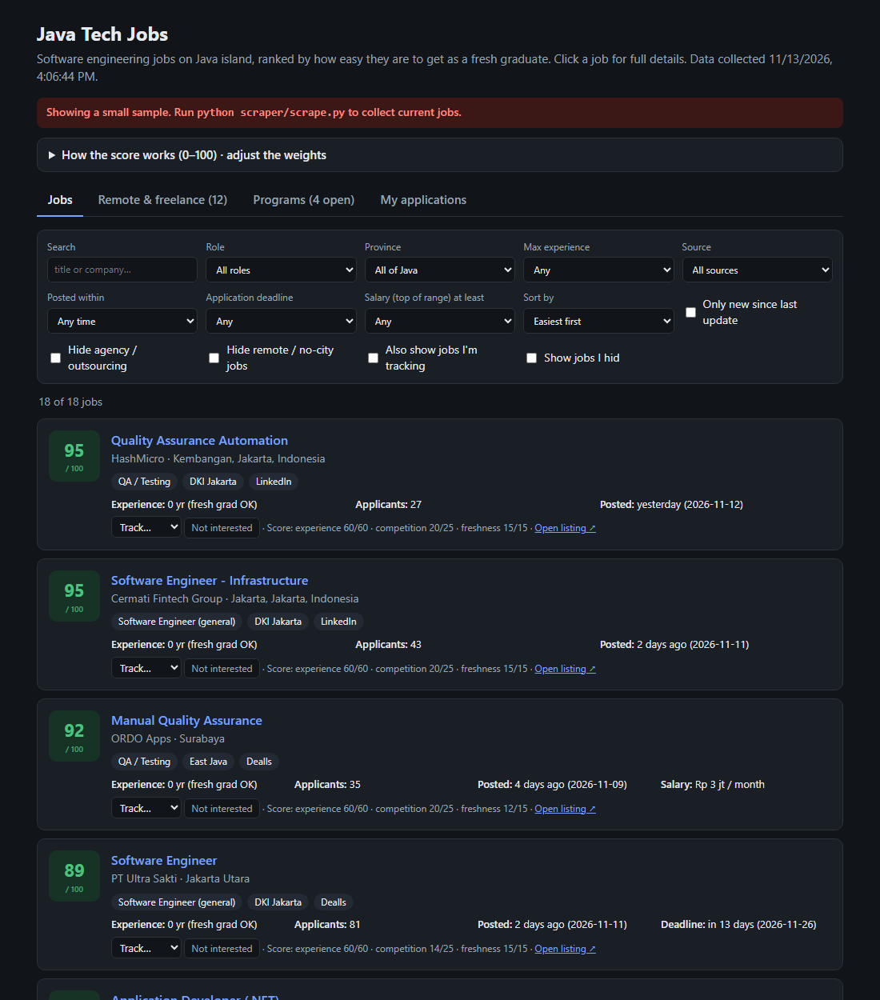
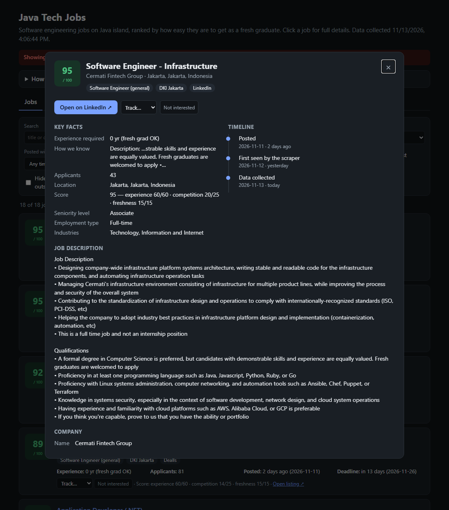

# Jobs Seeker

Kumpulan lowongan kerja IT untuk **fresh graduate**, dalam satu halaman web yang bisa dibuka langsung dari
komputer:

- **Lowongan di Pulau Jawa** dari job board Indonesia (Glints, Kalibrr, JobStreet, LinkedIn, Dealls) dan
  career site perusahaan (GoTo, Traveloka, Shopee, Grab, Xendit, dan lain-lain).
- **Remote & freelance** dari seluruh dunia yang menerima pelamar dari Indonesia dan cukup berbahasa Inggris.
- **Program musiman**: MagangHub Kemnaker, Magenta BUMN, Rekrutmen Bersama BUMN, CPNS/PPPK, Magang Bakti BCA,
  ODP bank, PCPM Bank Indonesia.

Setiap lowongan diberi **skor 0–100**: seberapa mudah lowongan itu didapat oleh fresh graduate, berdasarkan
pengalaman yang diminta, jumlah pelamar, dan umur lowongan.



## Fitur

- Filter role, provinsi, pengalaman maksimal, sumber, umur lowongan, deadline, gaji minimal.
- Popup detail: deskripsi lengkap, timeline (diposting, deadline), benefit, skill, info perusahaan,
  tahapan seleksi, dan riwayat jumlah pelamar.
- Label **NEW** untuk lowongan yang baru muncul sejak update terakhir.
- Tanda **Agency / outsourcing?** untuk lowongan yang kemungkinan dari agen penyalur.
- **Tracking lamaran** (Applied / Interview / Accepted / Rejected) di tab terpisah, dengan pengingat
  deadline ≤ 3 hari dan tanda kalau lowongan sudah hilang.
- Tombol **Not interested** untuk menyembunyikan lowongan.
- **Bobot skor** bisa diatur lewat slider.
- Gaji remote dan budget freelance ditampilkan juga dalam **Rupiah** (kurs harian).
- Scraper hemat: data yang sudah pernah diambil disimpan di cache dan tidak diambil ulang.



## Mulai cepat

Butuh **Python 3.10 atau lebih baru** (diuji dengan 3.13).

```bash
git clone https://github.com/shandirise/jobs-seeker.git
cd jobs-seeker
pip install -r requirements.txt
```

1. Buka `site/index.html` di browser. Sebelum scraper dijalankan, halaman menampilkan **contoh data kecil**
   dari `site/sample/`.
2. Ambil data terbaru:

   ```bash
   python scraper/scrape.py
   ```

   Run pertama sekitar 15–20 menit. Run berikutnya sekitar 5 menit karena memakai cache.
3. Reload halaman. Data asli tersimpan di `site/data/`.

Memperbarui satu tab saja:

```bash
python scraper/remote.py     # tab Remote & freelance
python scraper/programs.py   # tab Programs
```

## Update otomatis setiap hari (Windows)

```powershell
powershell -ExecutionPolicy Bypass -File scripts\register_task.ps1            # setiap hari jam 07:00
powershell -ExecutionPolicy Bypass -File scripts\register_task.ps1 -At 20:00  # jam lain
```

Skrip ini mendaftarkan task **Jobs Seeker refresh** di Task Scheduler. Task menjalankan `run_scraper.bat`, dan
kalau laptop mati pada jamnya, task jalan begitu laptop menyala. Log run terakhir ada di `scraper/last_run.log`.
Untuk menghapus task: `Unregister-ScheduledTask -TaskName "Jobs Seeker refresh"`.

## Struktur folder

```text
jobs-seeker/
├── scraper/
│   ├── scrape.py          # job board Jawa + career site perusahaan, skor, cache, penulisan output
│   ├── remote.py          # remote job & proyek freelance dari seluruh dunia
│   ├── programs.py        # cek status program musiman
│   ├── make_sample.py     # membuat site/sample/ dari data asli (tanpa data pribadi)
│   ├── companies.json     # daftar career site perusahaan
│   └── programs.json      # info program musiman yang ditulis manual
├── site/
│   ├── index.html         # website (satu file, tanpa server)
│   ├── sample/            # contoh data kecil (ikut di repository)
│   └── data/              # data hasil scraper (tidak ikut di repository)
├── scripts/
│   └── register_task.ps1  # jadwal harian di Windows
├── run_scraper.bat
├── requirements.txt
└── docs/                  # dokumentasi lengkap
```

## Dokumentasi

| Halaman | Isi |
| --- | --- |
| [Cara kerja](docs/cara-kerja.md) | Alur scraper, file output, cache, deduplikasi, file yang disimpan scraper |
| [Sumber data](docs/sumber-data.md) | Semua sumber, data apa yang diambil, dan sumber yang tidak bisa dipakai |
| [Skor dan label](docs/skor-dan-label.md) | Rumus skor, pembacaan pengalaman, role, provinsi, label NEW / agency, gaji |
| [Konfigurasi](docs/konfigurasi.md) | Menambah perusahaan, mengubah info program, kata kunci, batas, dan jadwal |

## Catatan penggunaan

- Dibuat untuk **pemakaian pribadi**. Scraper membaca halaman publik dengan jeda antar request dan cache
  supaya tidak membebani situs. Tetap patuhi ketentuan masing-masing situs.
- Data hasil scraping (termasuk nama dan email recruiter dari beberapa sumber) hanya disimpan di komputermu
  dan **tidak ikut di repository** (lihat `.gitignore`). Contoh data di `site/sample/` sudah dibersihkan dari
  nama, email, dan nomor telepon. Gunakan kontak recruiter hanya untuk melamar lowongan terkait.
- Skor, kategori role, dan label agency adalah tebakan dari teks lowongan, jadi bisa meleset. Selalu cek
  lowongan aslinya sebelum melamar.
